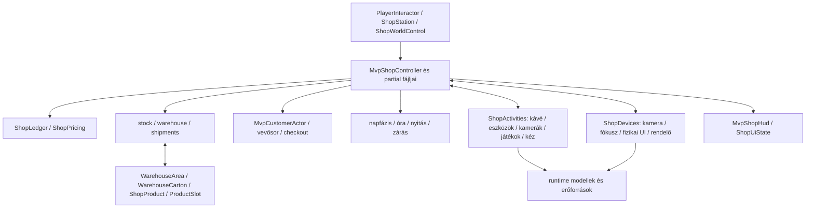

# #60 – Moduláris refaktor spike

Vizsgált forrás: `cadd47c`, Unity 6000.6.7f1, 2026-11-05. Statikus kódfelmérés; játékmeneti módosítás nem történt. A spike eredménye a döntés és a végrehajtható backlog. A hat új refaktorfeladat megvalósítása külön munka.

## Megvalósítás állapota

A #69–#74 follow-up feladatok végrehajtása elkészült. [Modulhatárok és tulajdonosok](REFACTOR_BATCH.md), [friss közös integrációs és WebGL-bizonyíték](../Acceptance/modular-refactor/REPORT.md). A lenti felmérés és becslések a spike időpontjának történeti állapotát írják le.

## Döntés

Indokolt a felelősségi körök fokozatos leválasztása. Először a beszerzési szabályokat érdemes kiemelni: kicsi, már ellenőrzött, pénz- és készletinvariánsokkal jól körülhatárolható terület. A jelenlegi MonoBehaviour komponensek maradjanak adapterek, így a scene/prefab hivatkozások megtarthatók.

55 C# fájl van az `Assets/Game/Scripts` alatt. A legnagyobbak: ShopAcceptanceProbe 637, MvpShopController 577, ShopActivities 400, ShopDevices 375, PlayerInteractor 314 fizikai sor. Ez méretjelzés, nem önmagában minőségi ítélet. A legnagyobb probe csak Editor/SHOP_ACCEPTANCE kód: nem érdemes pusztán a sorhossza miatt a shipping játékkód elé venni.

## Jelenlegi függőségek

| Határ | Jelenlegi tulajdonos és bizonyíték | Következmény |
|---|---|---|
| Összeállítás, nap, vevők, kassza, készlet | [MvpShopController](../../Assets/Game/Scripts/Mvp/MvpShopController.cs), különösen Awake/Start, Tick, OnDelivery, ResetDemo, OrderSupply | Egy változtatás sok más életciklust érinthet; a partial fájlokra bontás nem hozott létre külön állapottulajdonosokat. |
| Beszerzés és felület | [ShopOrderCart](../../Assets/Game/Scripts/Mvp/ShopOrderCart.cs): ShopDevices GUI és MvpShopController.OrderBasket ugyanabban a fájlban | A UI, validálás és könyvelés összekapcsolódik; OrderSupply és OrderBasket párhuzamos szabályokat tart fenn. |
| Kávé és egyéb tevékenységek | [ShopActivities](../../Assets/Game/Scripts/Mvp/ShopActivities.cs), [ShopCoffeeRecipes](../../Assets/Game/Scripts/Mvp/ShopCoffeeRecipes.cs) | Főzési állapot, kamera, eszközmodellek, kosz, minijáték és érme-kéz közös élettartamot kapott. |
| Fókusz és input | [ShopDevices](../../Assets/Game/Scripts/Mvp/ShopDevices.cs): Focus/Release; [ShopMenu](../../Assets/Game/Scripts/Mvp/ShopMenu.cs); [PlayerInteractor](../../Assets/Game/Scripts/Interaction/PlayerInteractor.cs); [ShopInputGate](../../Assets/Game/Scripts/Mvp/ShopLedger.cs) | A kurzor, kamera, pause és fogyasztott képkocka több helyről vezérelt. A közelmúlt terminál/kávé/ kézhibái ezt a határt érintették. |
| Fizikai áru és számláló | [WarehouseArea](../../Assets/Game/Scripts/Mvp/WarehouseArea.cs), [WarehouseCarton](../../Assets/Game/Scripts/Mvp/WarehouseCarton.cs), [ShopProduct](../../Assets/Game/Scripts/Interaction/ShopProduct.cs), [ShopCustomerOrders](../../Assets/Game/Scripts/Mvp/ShopCustomerOrders.cs) | A darabszám és a valódi tárgy külön nyilvántartás; a nézőpontok összekeverése elvesző vagy duplikált készletet okozhat. |
| Scene-kötés és erőforrások | [ShopFloorPlan.Find](../../Assets/Game/Scripts/Mvp/ShopFloorPlan.cs), ShopActivities.BuildTools/BuildCoffeeMachine, [ShopRegisterVisuals](../../Assets/Game/Scripts/Mvp/ShopRegisterVisuals.cs) | Szöveges tárgynevek és runtime létrehozás kötik össze a scene-t és a működést; minden mesh/material/audio/kamera felszabadításának külön gazdát kell kijelölni. |

Már használható alap a külön pénztárkönyv és pénzfiók, a ProductSlot/ShopProduct kapcsolat, a ShopRouteGrid, valamint a nyilvántartott ellenőrző suite-ok. Ezeket érdemes megtartani és határozottabb határokkal körülvenni.

Konkrét életciklus-kockázat: a controller OnDisable törli az Instance-t és leiratkozik a BasketSlot eseményéről; az OnEnable csak a delivery eseményre iratkozik vissza, míg az Instance Awake-ban, a BasketSlot feliratkozás Startban készül. Az újraengedélyezési útvonalat a bootstrap-feladatban külön kell ellenőrizni; ebben a spike-ban nem futott rá játékpróba, ezért ez kockázatként, nem igazolt hibajavításként szerepel.

## Célhatárok

- **Domain:** Unity-től és GUI-tól független szabályok, például beszerzési ajánlat, kasszakönyv, kávéfőzési állapot. Egyszerű bemenet/eredmény; globális singleton elérése nélkül.
- **Alkalmazási folyamat:** parancsok fogadása, validálás és tranzakció, fizikai adapterek összehangolása. Egyetlen írási tulajdonos minden pénz- és készletmódosításhoz.
- **Unity-adapter:** MonoBehaviour életciklus, colliderek, valódi csomagok/csészék, kamera és input; a meglévő publikus belépési pontok fokozatos delegálása.
- **Megjelenítés/összeállítás:** kijelzők, GUI, runtime modellek és scene-binding. Az adott építő felel a létrehozott erőforrások elengedéséért.

A modulok eleinte külön osztályok lehetnek a jelenlegi assembly-ben. Assembly definition és namespace költöztetés csak a függőségek rendezése után következzen, külön döntéssel. Nem szükséges rögtön DI-keretrendszer, általános event bus vagy minden adat ScriptableObject-be helyezése.

## Sorrend és backlog

| Prioritás | Issue | Becsült méret | Függőség és eredmény |
|---|---|---|---|
| 1, pilot | [#69 Beszerzési szabályok](https://github.com/t-simon-fr/NemzetiDohanyboltSzimulator/issues/69) | S, 1–2 szelet | Önállóan indulhat. Közös ajánlat/validálás, a jelenlegi UI és API megtartásával. |
| 2 | [#70 Készlet és szállítmányok](https://github.com/t-simon-fr/NemzetiDohanyboltSzimulator/issues/70) | M, 2–4 szelet | #69 után a közös beszerzési határra épül; először csak a szállítmányok gazdája válik le. |
| 3 | [#71 CheckoutSession](https://github.com/t-simon-fr/NemzetiDohanyboltSzimulator/issues/71) | M, 2–4 szelet | #70 készletnézete után. Explicit nyugtahelyek, többtermékes és ismételt műveletek. |
| 2, külön terület | [#72 Kávégép állapot](https://github.com/t-simon-fr/NemzetiDohanyboltSzimulator/issues/72) | M, 2–3 szelet | A pilot után önállóan tervezhető, de #70-nel közös készletfájl ne legyen párhuzamosan írva. |
| 3 | [#73 Nap és fókusz](https://github.com/t-simon-fr/NemzetiDohanyboltSzimulator/issues/73) | M, 2–4 szelet | A checkout és kávé publikus adapterei után; külön szelet a fókusz, külön a napfázis. |
| 4 | [#74 Bootstrap és látvány](https://github.com/t-simon-fr/NemzetiDohanyboltSzimulator/issues/74) | M, 3–4 szelet | Az előző modulhatárok stabilizálása után. Scene-binding és erőforrás-élettartam, nem grafikai áttervezés. |

S/M relatív komplexitás, nem vállalt időtartam. A refaktorok külön issue/PR alatt indulnak, nem részei a két spike mostani implementációjának.

## Az első pilot konkrét határa

#69 első szelete egy mellékhatásmentes beszerzési ajánlatot készít a kosárból, árakból, elérhető típusokból, szabad kapacitásból és pénzből. A jelenlegi OrderSupply/OrderBasket adapter előbb ezt kéri le, majd siker esetén egy lépésben könyvel és hozza létre a szállítmányt. A mutáló függvények csak a második szeletben vonhatók össze, ha az első API stabil.

Elfogadás: hibás későbbi kosársor nem módosítja a korábbi sort; nincs részleges pénzlevonás; nulla darab nem tétel; függő szállítás is beleszámít a 24-es kapacitásba; újrapróbálás nem duplikál. Célzottan `ledger`, `feature-batch`, `warehouse-storage`; a stabil runtime-csomagnak egy közös integráció és a változásnak megfelelő WebGL-próba kell. A GUI-nak, szerializált mezőknek és a nyolc másodperces szállításnak változatlanul kell működnie.

## Átvezetés és visszaállítás

1. Meglévő állapot/bemenetek rögzítése és a célzott ellenőrzések kiválasztása.
2. Új típus bevezetése, majd a régi publikus metódus delegáljon rá. Ne legyen egyszerre két írható igazságforrás.
3. Egy működő szelet → diff-review → releváns ellenőrzés → külön commit/PR. Visszaállítás a szelet commitjával lehetséges, adatkonverzió nélkül.
4. Csak bizonyítottan hivatkozás nélkül maradt régi útvonal távolítható el. A MonoBehaviour .meta/GUID, scene/prefab, PlayerPrefs-kulcsok és input enum-értékek megőrzendők.
5. A WebGL managed/shader stripping és az [Assets/Game/link.xml](../../Assets/Game/link.xml) módosítása külön vizsgálandó; domain-kiemelés miatt ne legyen általános stripping-kikapcsolás.

## A spike ellenőrzése

A kódhivatkozások, fájlszámok, modulhatárok és a hat follow-up issue felülvizsgálva. Csak dokumentáció változik; friss Unity-futtatást vagy WebGL-buildet ez a spike nem indokol. A korábbi 650 állításos jelentés a kiadott játék baseline-ja, nem a refaktor igazolása. A workflow-pilot és a dokumentációs hivatkozásellenőrzés eredménye a [#61 workflow-jelentésben](../Workflow/AI_WORKFLOW.md) követhető.
